Метрики:
- скорость реакции системы
- какие-нибудь нужно выбрать

Промпт:

Я участвую в кейс чемпионате и хочу, чтобы ты мне помог в разработке приложения для него. Суть приложения в том, чтобы обеспечить поддержку взаимодействия между врачом психотерапевтом и пациентом по тревожной/депрессивной симптоматике в России. 

Важным условием является тот факт, что приложение должно быть разработано за 3 дня.

Наше взаимодействие будет происходить по следующему алгоритму:
1. Разработаем модель предметной области согласно моим заметкам, нужно выделить Сущности, Объекты-значения, и Аггрегаты (согласно методологии Domain-Driven Design), а также взаимодействия между ними.

2. На основании модели примем решение о стеке разработки. Предполагается, что приложение должно состоять из Desktop приложения для Врача, Android приложения для Пациента, и сервера.

3. Напишем реализацию модели предметной области, с учётом всей её специфики.

4. Реализуем интерфейс пользователя 
5. Реализуем бэкенд

В ходе предыдущего разговора, мы определились со следующей моделью предметной области:

```plantuml
@startuml
title Модель предметной области приложения сопровождения пациента — MVP

left to right direction
skinparam packageStyle rectangle
skinparam classAttributeIconSize 0
hide empty methods

' =========================================================
' Учётные записи и связь врача с пациентом
' =========================================================
package "Учётные записи и связь" {

  abstract class Account <<Entity>> {
    +accountId: UUID
    +code: UserCode
    +personalData: PersonalData
    +createdAt: DateTime
  }

  class Patient <<Aggregate Root>> {
    +profile: PatientProfile
    +consent: Consent
  }

  class Doctor <<Aggregate Root>> {
    +profile: DoctorProfile
  }

  class AdminStub <<Role Stub>> {
    +available: Boolean
  }

  class CareRelationship <<Aggregate Root>> {
    +relationshipId: UUID
    +patientId: UUID
    +doctorId: UUID
    +createdAt: DateTime
    +endedAt: DateTime
    +status: RelationshipStatus
    +end(): void
  }

  class UserCode <<Value Object>> {
    +value: String
    +role: AccountRole
    +isValid(): Boolean
  }

  class PersonalData <<Value Object>> {
    +displayName: String
    +dateOfBirth: Date
  }

  class PatientProfile <<Value Object>> {
    +notes: String
  }

  class DoctorProfile <<Value Object>> {
    +specialty: String
  }

  class Consent <<Value Object>> {
    +accepted: Boolean
    +policyVersion: String
    +acceptedAt: DateTime
  }

  enum AccountRole {
    PATIENT
    DOCTOR
    ADMIN
  }

  enum RelationshipStatus {
    ACTIVE
    ENDED
  }

  Account <|-- Patient
  Account <|-- Doctor
  Account <|-- AdminStub

  Patient "1" -- "0..*" CareRelationship : участвует
  Doctor "1" -- "0..*" CareRelationship : участвует

  note right of UserCode
    Код пациента: PXXXXXX
    Код врача: VXXXXXX
    Точный формат X задаётся
    конфигурацией приложения.
  end note

  note right of CareRelationship
    В MVP связь создаётся сразу
    после ввода корректного кода.
    Подтверждение второй стороной
    не реализуется.
    Повторная активная связь той же
    пары врач–пациент не создаётся.
  end note
}

' =========================================================
' Назначения и выполнение
' =========================================================
package "Назначения и выполнение" {

  class Assignment <<Aggregate Root>> {
    +assignmentId: UUID
    +patientId: UUID
    +doctorId: UUID
    +type: AssignmentType
    +title: String
    +period: Period
    +schedule: Schedule
    +status: AssignmentStatus
    +details: AssignmentDetails
    +createdAt: DateTime
    +close(): void
    +pause(): void
    +resume(): void
    +cancel(): void
  }

  abstract class AssignmentDetails <<Value Object>>

  class MedicationDetails <<Value Object>> {
    +medicationId: UUID
    +dosage: Dosage
    +instructions: String
  }

  class QuestionnaireDetails <<Value Object>> {
    +questionnaireId: UUID
    +questionnaireVersionId: UUID
  }

  class AppCheckInDetails <<Value Object>> {
    +instructions: String
  }

  class JournalTaskDetails <<Value Object>> {
    +prompt: String
  }

  class Completion <<Aggregate Root>> {
    +completionId: UUID
    +assignmentId: UUID
    +patientId: UUID
    +completedAt: DateTime
    +comment: String
    +result: String
  }

  class MedicationIntake <<Value Object>> {
    +takenAt: DateTime
    +reportedAsTaken: Boolean
    +dosageTaken: String
  }

  class SideEffectReport <<Value Object>> {
    +effects: List<String>
    +comment: String
    +reportedAt: DateTime
  }

  class Period <<Value Object>> {
    +startsAt: DateTime
    +endsAt: DateTime
    +contains(dateTime): Boolean
  }

  class Schedule <<Value Object>> {
    +frequency: String
    +daysOfWeek: List<DayOfWeek>
    +timesOfDay: List<Time>
  }

  class Dosage <<Value Object>> {
    +amount: Decimal
    +unit: String
    +instructions: String
  }

  enum AssignmentType {
    MEDICATION
    QUESTIONNAIRE
    APP_CHECK_IN
    JOURNAL_TASK
  }

  enum AssignmentStatus {
    ACTIVE
    COMPLETED
    PAUSED
    EXPIRED
    CANCELLED
  }

  Assignment *-- "1" Period
  Assignment *-- "1" Schedule
  Assignment *-- "1" AssignmentDetails

  AssignmentDetails <|-- MedicationDetails
  AssignmentDetails <|-- QuestionnaireDetails
  AssignmentDetails <|-- AppCheckInDetails
  AssignmentDetails <|-- JournalTaskDetails

  Assignment "1" -- "0..*" Completion : выполняется через
  Completion *-- "0..1" MedicationIntake
  Completion *-- "0..1" SideEffectReport

  Patient "1" -- "0..*" Assignment : получает
  Doctor "1" -- "0..*" Assignment : создаёт

  note right of Assignment
    Назначение создаётся врачом
    для пациента при наличии
    активной CareRelationship.
    Статус меняется только через
    допустимые переходы.
  end note

  note right of Completion
    Одна Completion — одно выполнение
    активности или один запланированный
    случай выполнения.
    Для лекарственного назначения
    сохраняется только факт сообщения
    пациента о приёме; система не
    назначает препарат или дозировку.
  end note

  note right of Schedule
    Время расписания интерпретируется
    в часовом поясе пациента.
    Для хранения событий используется
    DateTime с однозначным смещением
    или UTC.
  end note
}

' =========================================================
' Опросники
' =========================================================
package "Опросники" {

  class Questionnaire <<Aggregate Root>> {
    +questionnaireId: UUID
    +name: String
    +isActive: Boolean
  }

  class QuestionnaireVersion <<Entity>> {
    +questionnaireVersionId: UUID
    +version: String
    +scoringRule: ScoringRule
    +lowScoreThreshold: Decimal
    +createdAt: DateTime
    +isActive: Boolean
  }

  class Question <<Value Object>> {
    +questionId: UUID
    +text: String
    +answerType: AnswerType
    +options: List<String>
    +scoreMapping: Map
  }

  class ScoringRule <<Value Object>> {
    +description: String
    +calculate(answers): Decimal
    +classify(score): ResultCategory
  }

  class QuestionnaireAttempt <<Aggregate Root>> {
    +attemptId: UUID
    +questionnaireId: UUID
    +questionnaireVersionId: UUID
    +patientId: UUID
    +assignmentId: UUID
    +answers: List<Answer>
    +score: Decimal
    +resultCategory: ResultCategory
    +completedAt: DateTime
  }

  class Answer <<Value Object>> {
    +questionId: UUID
    +value: String
    +score: Decimal
  }

  enum AnswerType {
    SINGLE_CHOICE
    MULTIPLE_CHOICE
    SCALE
    FREE_TEXT
  }

  enum ResultCategory {
    LOW
    MODERATE
    HIGH
    OTHER
  }

  Questionnaire "1" *-- "1..*" QuestionnaireVersion
  QuestionnaireVersion "1" *-- "1..*" Question
  QuestionnaireVersion *-- "1" ScoringRule
  QuestionnaireAttempt "1" *-- "1..*" Answer

  Questionnaire "1" -- "0..*" QuestionnaireAttempt : используется в
  QuestionnaireVersion "1" -- "0..*" QuestionnaireAttempt : версия попытки
  Patient "1" -- "0..*" QuestionnaireAttempt : проходит
  Assignment "0..1" -- "0..*" QuestionnaireAttempt : основание

  note right of QuestionnaireVersion
    Завершённая попытка всегда
    ссылается на конкретную версию.
    Вопросы, правила подсчёта и пороги
    этой версии после публикации
    не изменяются.
  end note

  note right of ScoringRule
    Порог и правила подсчёта задаются
    отдельно для каждой версии опросника.
    Результаты разных опросников
    не сравниваются по общей шкале.
  end note
}

' =========================================================
' Дневник и отметки состояния
' =========================================================
package "Дневник и состояние" {

  class JournalEntry <<Aggregate Root>> {
    +entryId: UUID
    +patientId: UUID
    +text: String
    +reflectionPrompt: String
    +createdAt: DateTime
    +updatedAt: DateTime
  }

  class MoodCheckIn <<Aggregate Root>> {
    +checkInId: UUID
    +patientId: UUID
    +answers: List<MoodAnswer>
    +comment: String
    +createdAt: DateTime
  }

  class MoodAnswer <<Value Object>> {
    +question: String
    +value: String
  }

  Patient "1" -- "0..*" JournalEntry : ведёт
  Patient "1" -- "0..*" MoodCheckIn : отмечает
  MoodCheckIn "1" *-- "1..*" MoodAnswer
}

' =========================================================
' Индикатор состояния и уведомления
' =========================================================
package "Наблюдение и уведомления" {

  class PatientStatus <<Value Object>> {
    +color: StatusColor
    +reasons: List<StatusReason>
    +calculatedAt: DateTime
  }

  class StatusReason <<Value Object>> {
    +kind: StatusReasonKind
    +description: String
    +observedValue: String
    +period: Period
  }

  class StatusPolicy <<Domain Service>> {
    +missedMedicationThreshold: Integer
    +missedMedicationPeriod: Duration
    +lowScoreCountThreshold: Integer
    +evaluate(patientId): PatientStatus
  }

  class MedicationAdherence <<Value Object>> {
    +missedCount: Integer
    +period: Period
  }

  class QuestionnaireTrend <<Value Object>> {
    +questionnaireId: UUID
    +questionnaireVersionId: UUID
    +consecutiveLowResults: Integer
    +threshold: Decimal
  }

  class Notification <<Aggregate Root>> {
    +notificationId: UUID
    +recipientId: UUID
    +patientId: UUID
    +type: NotificationType
    +message: String
    +createdAt: DateTime
    +readAt: DateTime
  }

  enum StatusColor {
    GREEN
    YELLOW
    RED
  }

  enum StatusReasonKind {
    MISSED_MEDICATIONS
    STABLY_LOW_QUESTIONNAIRE_RESULTS
  }

  enum NotificationType {
    PATIENT_STATUS_CHANGED
    MEDICATION_SIDE_EFFECT_REPORTED
    ASSIGNMENT_REMINDER
    QUESTIONNAIRE_COMPLETED
  }

  Patient "1" -- "0..1" PatientStatus : текущий статус
  StatusPolicy ..> MedicationAdherence : анализирует
  StatusPolicy ..> QuestionnaireTrend : анализирует
  StatusPolicy ..> PatientStatus : рассчитывает
  StatusPolicy ..> Completion : использует
  StatusPolicy ..> QuestionnaireAttempt : использует

  Patient "1" -- "0..*" Notification : получает
  Doctor "1" -- "0..*" Notification : получает
  Notification "*" --> "0..1" Patient : о пациенте

  note right of StatusPolicy
    Для MVP пропуск рассчитывается
    по активному назначению и его
    расписанию за настроенный период.
    Пауза и завершение назначения
    исключают его из расчёта.

    Низкие результаты сравниваются
    только в рамках одного опросника
    и заданных правил его версии.
  end note

  note right of PatientStatus
    Индикатор для врача, а не диагноз
    и не самостоятельная оценка
    экстренности ситуации.
    Всегда отображаются основания,
    период и время расчёта.
  end note
}

' =========================================================
' Поддержка и геймификация
' =========================================================
package "Поддержка и геймификация" {

  class SupportContent <<Entity>> {
    +contentId: UUID
    +trigger: String
    +message: String
    +contentType: SupportContentType
  }

  class ForestState <<Aggregate Root>> {
    +forestId: UUID
    +patientId: UUID
    +growthLevel: Integer
    +updatedAt: DateTime
    +applyActivity(activity): void
  }

  class ForestActivity <<Value Object>> {
    +activityType: String
    +occurredAt: DateTime
    +points: Integer
  }

  enum SupportContentType {
    ENCOURAGEMENT
    REFLECTION
    CONTACT_DOCTOR_PROMPT
  }

  Patient "1" -- "0..1" ForestState : имеет
  ForestState *-- "0..*" ForestActivity
  SupportContent ..> JournalEntry : может предлагаться после
  SupportContent ..> MoodCheckIn : может предлагаться после
  SupportContent ..> QuestionnaireAttempt : может предлагаться после

  note right of SupportContent
    Для MVP — подготовленные сообщения,
    без генерации медицинских советов
    и рекомендаций по лечению.
  end note
}

' =========================================================
' Каталог препаратов
' =========================================================
package "Справочники" {

  class Medication <<Catalog Entity>> {
    +medicationId: UUID
    +name: String
    +groupId: UUID
    +instructionText: String
  }

  class MedicationGroup <<Catalog Entity>> {
    +groupId: UUID
    +name: String
    +description: String
  }

  MedicationGroup "1" -- "0..*" Medication : включает
  Medication "1" -- "0..*" MedicationDetails : выбирается в
}

' =========================================================
' Межагрегатные ссылки
' =========================================================
CareRelationship ..> Patient : связывает по patientId
CareRelationship ..> Doctor : связывает по doctorId

Assignment ..> CareRelationship : проверяет активную связь
Assignment ..> Questionnaire : может ссылаться на
Assignment ..> QuestionnaireVersion : фиксирует версию
Assignment ..> Medication : может ссылаться на

@enduml
```

Также определились со стеком:

1. Flutter desktop приложения для Врача
2. Flutter Android приложения для Пациента
3. Сервер на GO
4. База данных Sqlite

Теперь, реализуй мне модель для фронта на flutter так, чтобы он работал и на Android и на Desktop